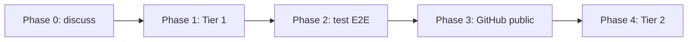

# Release roadmap — clone-and-run + features

Discussion doc before we test, package, and publish to GitHub.

**Goal:** Someone clones the repo, runs one setup command, enables the mod in-game, and watches an LLM play Songs of Syx.

---

## Already done (this session)

| Item | Notes |
|------|-------|
| **Wiki in repo** | `wiki/` — playbook, rules, architecture, prior art |
| **Memory → wiki sync** | Each tick writes `wiki/memory/live-log.md` |
| **Portable paths** | `bridge/bridge/paths.py` + env overrides |
| **Playbook from repo** | Default `wiki/rules/playbook.md`, not Obsidian vault |
| **Ollama default** | `localhost:11434` instead of hardcoded Unraid IP |
| **Standalone sync script** | `scripts/sync-memory-to-wiki.py` for cron/n8n |

---

## Tier 1 — Must ship for “grab and run”

These block a public GitHub release. Recommend doing all before first post.

### 1. `install.sh` (or `make setup`)

One script that:

1. Checks **Java 21**, **Python 3.11+**, **Maven** (or uses `./mvnw`)
2. Detects **Songs of Syx** JAR:
   - Steam: `~/.steam/steam/steamapps/common/Songs of Syx*/SongsOfSyx.jar`
   - Demo path, GOG, or `$SONGSOFSYX_JAR`
3. Writes `bridge/config.yaml` from example if missing
4. Creates Python venv + `pip install -r bridge/requirements.txt`
5. Builds mod: `cd syx-llm-mod && ./mvnw install -P linux -Dgame.jar.path=...`
6. Prints **next steps** (enable mod in launcher, set API key)

**Your call:** ship venv in repo instructions vs `pip install --user`?

### 2. `run.sh` launcher **in the repo**

Today the real launcher lives at `/home/hermesprime/GAMES/Neonoodles-ctrl/syx/syx` with monitor-pin logic that's Ivan-specific.

For GitHub we need a **minimal** repo-local launcher:

```bash
./run.sh          # build mod if needed, start bridge, print game instructions
./run.sh bridge   # bridge only (game already running)
./run.sh build    # mod only
```

Strip: MSI monitor pin, xdotool auto-enable, `.hermes/.env` hard dependency.

### 3. De-hardcode paths

| Current | Fix |
|---------|-----|
| `restart-game-only.sh` path in `main.py` | `SYX_RESTART_SCRIPT` env or skip restart API on generic install |
| `pom.xml` game.jar.path | Property from env / install.sh |
| Game version **V69** | Document in README; consider `SYX_GAME_VERSION` property |
| Memory in GAMES path | ✅ now `logs/overlord-memory.jsonl` in repo |

### 4. README rewrite

- Prerequisites checklist (game version, JDK, API key)
- 5-step quick start with screenshots placeholders
- Architecture diagram (fix port 8472 → 3847 typo)
- Config table: Ollama vs OpenRouter vs OpenAI
- “What works” vs stub commands (honest list)
- Troubleshooting: mod not reachable, TmpArea errors, wrong coords

### 5. `.env.example` + config docs

✅ `.env.example` added. README should say: copy it, export key, run.

### 6. License + attributions

- MIT (already stated)
- Songs of Syx is commercial — “requires owned copy”; mod uses game JAR at build time only
- Credit Arg0n mod example if we forked patterns

---

## Tier 2 — Strongly recommended (quality + retention)

### 7. First-run dashboard wizard

On `GET /` when mod unreachable:

- Red/green checklist: game running? mod enabled? API key set?
- Link to wiki playbook
- “Test LLM” button (ping model without game)

### 8. `--dry-run` / mock game mode

Bridge runs decision loop against **fixture state JSON** so users can verify LLM + dashboard without loading a save.

```
python -m bridge --dry-run fixtures/early_settlement.json
```

Great for CI and for people waiting on first mod build.

### 9. Richer game state for the LLM

`StateReader` only reports `stockpile_crates` for rooms — overlord is half-blind.

- Enumerate room types + counts
- Food/water/housing pressure signals
- Last N build failures in state JSON (not just memory)

### 10. Implement or remove stub commands

Playbook says only `build` + `set_speed` work. Either:

- **A)** Remove stubs from prompt (less confusion), or
- **B)** Implement `set_tax`, `set_ration`, `demolish` (high value, more Java work)

Recommend **A for v1**, **B as v1.1**.

### 11. Session profiles

```
logs/sessions/<save-name>/overlord-memory.jsonl
```

Switch memory when loading different saves — avoids “wrong throne coords” from old session.

### 12. Failure → playbook hints (semi-auto)

When same failure repeats 3×, append a one-line hint to a `wiki/rules/learned.md` (human-reviewed) or surface in dashboard “suggested playbook edit”.

### 13. n8n workflow (optional)

Your infra already has n8n. Ship a JSON workflow export:

- Webhook on tick → append to Obsidian vault (if user points vault path)
- Or hourly `sync-memory-to-wiki.py`

Not required for generic users; nice for you.

---

## Tier 3 — Nice to have / v2

| Feature | Why |
|---------|-----|
| **In-game chat channel** | Talk to overlord from game UI (Java UI work) |
| **Multiple overlord personas** | Different playbooks / models per profile |
| **Replay / tick recording** | JSONL of full state for debugging |
| **GitHub Actions** | Build mod JAR artifact (needs cached game JAR — tricky legally) |
| **Docker for bridge only** | `docker compose up bridge` — mod still native |
| **Windows install.ps1** | Broader audience |
| **Workshop packaging** | Distribute mod without full repo |
| **Local model presets** | Curated list for 8–12 GB VRAM |
| **Cost tracker** | OpenRouter token spend per session |

---

## Suggested release phases



### Phase 1 build order (if you agree)

1. `install.sh` + `run.sh`
2. README + path cleanup
3. Dry-run mode (fast win for testers)
4. StateReader room expansion
5. Dashboard first-run checklist

### Phase 2 test plan

- [ ] Fresh clone in `/tmp`, run `install.sh`, no Ivan paths
- [ ] OpenRouter key only — one tick, one successful `build`
- [ ] Ollama local — wake + tick
- [ ] Edit `wiki/rules/playbook.md` — verify next tick behavior
- [ ] Verify `wiki/memory/live-log.md` updates
- [ ] Restart bridge — memory persists
- [ ] Game restart via dashboard (if we keep that API)

---

## Decisions for you

1. **Repo name / GitHub org?** `neonoodles-ctrl/syx-llm-overlord`?
2. **Include GAMES launcher** in repo or keep separate personal dotfiles?
3. **Default LLM provider** in example config: Ollama local vs OpenRouter?
4. **Game version pinning:** support only V69 or document bump process?
5. **Obsidian:** repo wiki is canonical; sync to your vault via symlink/git submodule, or leave vault as copy?
6. **Scope v1:** ship with stubs documented, or delay release until `demolish` works?

Reply with priorities (e.g. “Tier 1 only, OpenRouter default, no restart API”) and we implement before the test pass.
